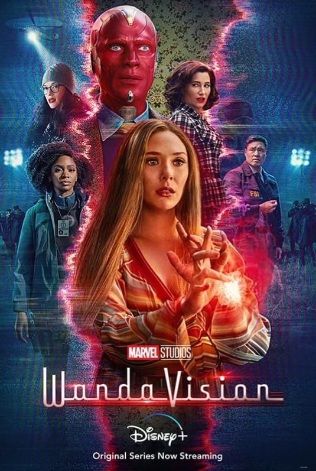

# WandaVision

> "What is grief, if not love persevering?"

## About the Series

**WandaVision** is a Marvel Studios television series released in 2021. It follows Wanda Maximoff and Vision as they live in a seemingly perfect suburban town called *Westview*.

The series combines the genres of **superhero fiction, mystery, drama, and sitcom comedy**, with each episode inspired by a different era of television.

---

## Main Characters

| Character | Actor | Description |
|---|---|---|
| Wanda Maximoff | Elizabeth Olsen | A powerful individual known as the Scarlet Witch. |
| Vision | Paul Bettany | An android and Wanda's partner. |
| Agatha Harkness | Kathryn Hahn | A mysterious witch with her own plans. |
| Monica Rambeau | Teyonah Parris | An agent investigating the events in Westview. |

## What Makes It Interesting?

Here are some things I love about the series:

- **Unique storytelling** – Each episode represents a different sitcom era.
- **Mystery** – The strange events in Westview keep viewers guessing.
- **Character development** – It explores Wanda's emotions and personal struggles.
- **Visual presentation** – The changing costumes, settings, and cinematography make every episode interesting.

## My Favorite Aspects

1. The different sitcom-inspired settings.
2. Wanda and Vision's relationship.
3. The unexpected plot twists.
4. The soundtrack and visual effects.

## Quick Information

| Category | Details |
|---|---|
| Release Year | 2021 |
| Genre | Superhero, Drama, Mystery, Sitcom |
| Episodes | 9 |
| Studio | Marvel Studios |
| Universe | Marvel Cinematic Universe |

## Final Thoughts

*WandaVision* is one of my favorite Marvel series because it presents a different kind of superhero story. It combines humor, mystery, and emotional storytelling in a creative way.

**It is more than just a superhero series; it is also a story about love, loss, and moving forward.**

---

For more information, visit the [official Marvel website](https://www.marvel.com/tv-shows/wandavision/1).
